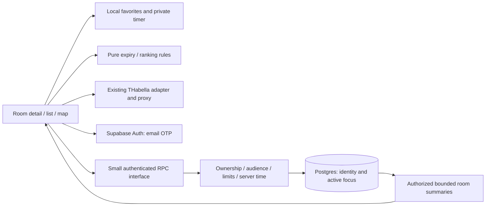

# ADR 0001: individual room study presence

Status: implementation contract proposed for M1-S1; operational activation remains gated. Date: 10 October 2026. Scope authority: [project charter](../PROJECT-CHARTER.md). Tracks [#17](https://github.com/arudaev/THD-Room-Finder/issues/17); component implementation remains [#21](https://github.com/arudaev/THD-Room-Finder/issues/21).

## Decision

Keep Vite/React, local favorites and the existing THabella proxy. Add one narrowly scoped Supabase Auth/Postgres capability for remembered identity and expiring individual focus. Use bounded HTTP reads and transactional RPC writes initially; no per-person realtime subscriptions, push, event service or additional database vendor. A private local timer needs neither sign-in nor shared-service availability.

Use email one-time-code sign-in for recoverable shared identity. Ask once when sharing is first chosen, then remember the session; never ask for university credentials. Production requires a configured mail provider, delivery/abuse limits and tested Android/PWA login persistence. Provider email verification verifies control of an email address, **not** university membership, degree or batch. Anonymous Supabase identities and social OAuth remain alternatives, not simultaneous M1 dependencies. [Supabase email OTP](https://supabase.com/docs/guides/auth/auth-email-passwordless).

These are modules in the existing app and one Supabase project, not independently deployed microservices. Prefer direct user-JWT RPC calls over an extra Vercel proxy for every heartbeat. Database policies and RPC admission checks must therefore protect **direct** requests; hiding the endpoint or placing optional checks in the UI cannot secure it.

## Identity and audience

Store an Auth user ID, chosen display name (1–32 characters), canonical degree ID, entry cohort ID, audience preference and optional name-display consent. Do not store email again in the public profile. Display names are non-unique; no global handle directory or username search is needed for M1. Preferences survive returning visits; favorites remain local. A user's selected accent is never an access-control input.

Maintain a versioned taxonomy of campus, degree and entry cohort. Entry cohort means a degree's start intake (year plus winter/summer), not a semester number that changes automatically. Use a clearly labeled “not listed” route and private timer until a valid choice exists; do not guess degree equivalence. Identity fields are self-declared, so matching is a discovery aid rather than a trusted student-membership boundary. Changing degree/cohort ends the shared session first to prevent a session changing audience silently.

| Sharing choice | Owner | Authenticated same degree AND entry cohort | Other viewers |
|---|---|---|---|
| Private local | Local controls only | No signal | No signal |
| Classmates + campus activity | Full own session | Matching cohort label, mode, aggregate count; display name only with separate consent | Coarse “study activity reported”, no name, cohort or per-person ID |
| Campus details | Full own session | Publicly selected details | Selected degree/cohort label and mode; display name only with separate consent |

Setup must explicitly explain the coarse campus signal for the classmates choice. Calling this “private to classmates” would be misleading. Quiet/open mode is independent: quiet asks others not to interrupt; open welcomes company but still belongs to one person. Broader audience and name display are never inferred from choosing open. “Campus details” is optional and off by default. Public/coarse reads may support accountless room discovery; fine detail requires a verified application session or explicit campus-detail consent.

No GPS, physical-presence claims, attendance history, public favorite counts, friends or organization-role assertions. A favorite is never a check-in. A single viewer may infer activity from even one coarse signal; explain this before sharing rather than claim anonymity.

A returning signed-in student starts with one tap using the visibly summarized remembered duration/mode/audience. Optional session settings can change those choices; do not require a configuration sheet on every start. Initial sharing setup/sign-in is separate. Current profile consent and per-session choices jointly bound visibility: narrowing consent applies immediately to reads; broadening a default does not silently broaden an active session.

## Data and access contract

| Record | Purpose | Access |
|---|---|---|
| `student_identity` | Minimal chosen identity and current audience/name consent | Owner read/update only; sharing uses filtered RPC output |
| `focus_session` | Owner, campus/room key, quiet/open, chosen end, version, device lease token hash, last accepted renewal, expiry | Owner read; mutations through validated transactions |
| `presence_budget` | Bounded admission counters, no room or identity history | Service-maintained; not readable by clients |
| `degree_cohort_catalog` / `eligible_room_catalog` | Versioned canonical values | Public bounded reads; maintainer-managed writes |

Use campus ID plus canonical THabella room ident for a room key; the display code E203 alone is insufficient. Refresh a minimal eligible-room catalogue through a bounded maintainer-owned import. Shared writes reject unknown or excluded venues. Teaching eligibility still comes from the existing domain rules; the database must not accept an arbitrary user-created room.

Enable RLS on records and deny other users' raw profiles/sessions. Use invoker functions with owner policies where possible. A summary function may need carefully audited `security definer` access to aggregate other users: fix its empty search path, schema-qualify relations, narrow execute grants, derive identity from the validated JWT and apply audience/expiry predicates **before** projection. Never accept a caller-supplied viewer/cohort as authority. Do not expose a table/view that bypasses the summary policy. Test direct table and RPC access with unrelated JWTs, not only the UI. [Function security](https://supabase.com/docs/guides/database/functions), [API protection](https://supabase.com/docs/guides/api/securing-your-api).

All operations validate types, length, catalogue IDs and timestamps. Publishable keys may be public; service-role/admin tokens must never enter app code, previews' browser bundles, screenshots or logs. An RPC implemented with a privileged role is not protected merely by enabling RLS: its body and grants are part of the security boundary.

| Logical operation | Inputs | Result and rules |
|---|---|---|
| `save_identity` | Chosen fields and expected version | Own record; allowlisted values, no role/org claims |
| `start_focus` | Room key, duration, quiet/open, audience, name consent, request ID | Server session ID/version, server time, absolute end and expiry; atomic one-active-session constraint |
| `renew_focus` | Owned session, lease token, expected version | New bounded expiry; cannot extend absolute end or mutate room/audience |
| `update_focus` | Owned session, mode/audience/name consent, expected version | New version and filtered visibility immediately; narrower consent takes effect on next read |
| `end_focus` | Owned session and request ID | Idempotent end/revocation; no “already ended” error loop |
| `room_summaries` | One campus and up to 30 room keys | Bounded authorized DTOs with server observation/expiry times; no raw owner IDs |
| `delete_identity` | Reauthenticated own identity | Revoke focus first, then delete profile/Auth identity through trusted operation |

Use server transactions, unique owner constraint and idempotency keys. Race two starts: same request returns the same result; a different room/device receives a conflict with an explicit end/replace choice. Never silently steal a running session. Store token hashes, not raw device lease secrets. Cap the chosen session at three hours for the pilot; extending it means an explicit new segment after checking the timetable again.

In the UI, shared start requires a current, sufficiently fresh “now” schedule, an open campus and a teaching-eligible room free for the chosen duration; offer shorter duration when the next lecture is earlier. Offline/unknown/future-time views retain local focus but cannot publish a new shared claim. The minimal service validates the room catalogue and bounded duration, not a fresh THabella request on every start/renewal. A malicious or outdated client therefore cannot make its self-report authoritative: occupied lectures still win in every list/map/detail, and presence never reserves a room.

## Lease and client state

Start at server time `s`: `absoluteEnd = s + chosenDuration`; `expiresAt = min(absoluteEnd, s + 300 seconds)`. While visible, renew at 60 seconds plus 0–5 seconds jitter. Reject renewal before a 45-second minimum interval, for an expired/ended session, wrong owner/token or stale version. Accepted renewal uses server time and the same bounded expiry. No delayed request can resurrect an expired session. The 45-second admission floor tolerates ordinary cadence variation; it is not the client target.

```mermaid
stateDiagram-v2
    [*] --> Idle
    Idle --> Starting: explicit start
    Starting --> Active: server accepted
    Starting --> Idle: rejected / local timer chosen
    Active --> HiddenGrace: page hidden; stop renewal and pause credit
    HiddenGrace --> Active: visible before expiry; explicit resume and accepted renewal
    Active --> Reconnecting: renewal unavailable
    Reconnecting --> Active: accepted renewal before expiry
    Reconnecting --> Expired: expiry reached
    HiddenGrace --> Expired: expiry reached
    Active --> Ended: end / absolute end
    Expired --> Starting: explicit new segment
    Ended --> Idle
```

Use a timestamp-derived local timer, not accumulated `setInterval` ticks. Hidden pages pause personal focus credit under the selected model; do not implement background keepalive. A failed end request removes the owner's local active UI, explains remote expiry, and relies on TTL. After expiry, opening the tab cannot silently start again. Screen wake lock is optional; loss of the lock is displayed and does not manufacture a heartbeat.

One browser tab owns renewal (browser lock where supported plus a server lease token); other tabs show the session read-only. Server constraints remain authoritative where browser locks are absent. Sign-out attempts end, clears cached identity/summary data and relies on TTL if offline. Focus/session identity is never stored in shareable room URLs.

Read summaries once for the visible room/detail set, then at most every 60 seconds; stop while hidden or on unrelated screens. Remove each marker at its server-provided expiry without waiting for another poll. After 90 seconds without a successful read, show activity unknown and stop using it for ranking. Schedule-only ranking remains the fallback. Never cache personalized presence in the service worker/CDN or localStorage; use `no-store` and memory-only DTOs. THabella's existing public caching stays separate.

## Ordering and component seam

Existing room eligibility, query-time availability, duration and access constraints run first. For otherwise suitable rooms, default activity bucket 0 = no reported activity or authorized same-degree/same-cohort activity; bucket 1 = unrelated activity. Preserve existing duration/tiebreak ordering within each bucket. Quiet preference moves all activity to bucket 1. Expired/unknown summaries restore schedule-only order; unknown must not be labeled empty. Live presence appears only for “now”, never attached to a historical/future time-travel result.

The activity row sits below the existing availability window. Building badges summarize study activity without changing timetable fill colors. Detail owns Start/End; a compact active control persists across navigation. A shared session is not a booking and does not hide the room from other students. Proposed component and state requirements are documented in the [design-session brief](../docs/Design-Session-Brief.md).

## Retention and failure boundary

No completed focus history in M1. Stop returning expired/revoked records immediately; physically delete them within 24 hours with a tested scheduled cleanup. Remove idempotency/budget rows within 24 hours of their window ending. Keep operational logs for at most seven days with error code, latency and aggregate request metrics; no email, display name, JWT, room/session IDs or cohort in logs. Document processor backup retention separately; application deletion is not a promise of immediate backup erasure. Identity persists until deletion. Deletion/revocation acceptance must test future reads and backup-policy disclosures.

Use feature-off defaults until activation checks pass. A presence outage does not block browsing/favorites/local focus. Show failure once with bounded backoff; never retry every timer tick. Auth failure requires sign-in/recovery or private local use. Avoid promises of guaranteed physical occupancy, delivery or room access.

## Environment evidence and activation

Read-only checks on 10 October 2026 confirmed the linked Vercel project, a READY preview deployment and enabled preview authentication. The authenticated Supabase CLI listed existing projects but **no THD Room Finder project**, and this repo has no Supabase project link. Other projects' database names, IDs, data and credentials are deliberately omitted. The available reads did not expose subscription/branch entitlement, current billed usage or a project-specific spend ceiling. No such entitlement is claimed.

Therefore start with a local Supabase instance and synthetic identities once implementation begins. Do not reuse another app's production database or create paid branches to fill the evidence gap. Later choose one isolated preview project, then ephemeral branching only if measured need and entitlement/cost justify it. Branch instances have separate credentials and billable usage; they are not covered by Spend Cap. [Branch usage](https://supabase.com/docs/guides/platform/manage-your-usage/branching), [cost controls](https://supabase.com/docs/guides/platform/cost-control).

Before hosted activation, verify actual plan/region/mail provider/branch entitlement, a maintainer-selected monthly allowance, preview binding and migration ownership using [the acceptance checklist](pilot-verification.md). No new paid service is authorized by this ADR alone. Implementation can proceed locally while this gate remains open; #17 stays open until its entitlement/cost criterion has evidence.
